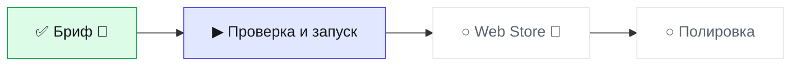

# Статус · topath-saver · BRO v3.0
Обновлено 2026-10-12 23:52 · режим JOIN · волна W1-INIT

▰▰▱▱▱▱▱▱ **1 из 4 · 25 %** · сейчас «Проверка и запуск» · ход за 🤖 кодер

**Тебе:** ничего — ждём «Готово» от кодера · **Дальше:** 🛑 Web Store через 1 шаг.

| Показатель | Значение |
|---|---|
| 🎯 Принято с первого раза | - |
| 🙈 Ложные «готово» | 0 |
| ⏱ Последняя волна: работа / ожидание, мин | - / - |
| 🪙 ≈ptok на принятую задачу | - |
| 🔌 Обращений к GitHub за волну (среднее) | - |

Волны · 0

| W | verdict | done/tasks | defects | min | GitHub |
|---|---|---|---|---|---|

Страница на ПК: `.bro\progress.html` (двойной щелчок).
