# Статус · topath-saver · BRO v3.0
Обновлено 2026-10-13 02:38 · режим JOIN · волна W3-FIX

▰▰▰▰▱▱▱▱ **3 из 6 · 50 %** · сейчас «Фикс + Gmail 0.2.0» · ход за 🤖 кодер

**Тебе:** ничего — ждём «Готово» от кодера · **Дальше:** 🛑 Фикс + Gmail 0.2.0 — сейчас

```mermaid
flowchart LR
  n0["✅ Бриф 🛑"]:::done
  n1["✅ Проверка и запуск"]:::done
  n0 --> n1
  n2["✅ Авторы и релиз 🛑"]:::done
  n1 --> n2
  n3["▶ Фикс + Gmail 0.2.0 🛑"]:::run
  n2 --> n3
  n4["○ Web Store 🛑"]:::todo
  n3 --> n4
  n5["○ Полировка"]:::todo
  n4 --> n5
  classDef done fill:#DCFCE7,stroke:#16A34A,color:#16181D
  classDef run fill:#E0E7FF,stroke:#4F46E5,color:#16181D
  classDef wait fill:#FEF3C7,stroke:#D97706,color:#16181D
  classDef todo fill:#FFFFFF,stroke:#E6E7EB,color:#5B6170
  classDef pause fill:#F3F4F6,stroke:#9CA3AF,color:#5B6170
  classDef frozen fill:#F3F4F6,stroke:#9CA3AF,color:#5B6170
```

| Показатель | Значение |
|---|---|
| 🎯 Принято с первого раза | 1/2 |
| 🙈 Ложные «готово» | 0 |
| ⏱ Последняя волна: работа / ожидание, мин | 6 / 9 |
| 🪙 ≈ptok на принятую задачу | 1595 |
| 🔌 Обращений к GitHub за волну (среднее) | 7 |

Волны · 2

| W | verdict | done/tasks | defects | min | GitHub |
|---|---|---|---|---|---|
| W1-INIT | PARTIAL | 5/6 | 3 | 11 | 9 |
| W2-RELEASE | PASS | 6/6 | 0 | 6 | 5 |

Страница на ПК: `.bro\progress.html` (двойной щелчок).
