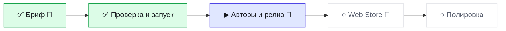

# Статус · topath-saver · BRO v3.0
Обновлено 2026-10-13 00:34 · режим JOIN · волна W2-RELEASE

▰▰▰▱▱▱▱▱ **2 из 5 · 40 %** · сейчас «Авторы и релиз» · ход за 🧠 аналитик

**Тебе:** напиши аналитику: BRO CHECK · **Дальше:** 🛑 Авторы и релиз — сейчас

| Показатель | Значение |
|---|---|
| 🎯 Принято с первого раза | 0/1 |
| 🙈 Ложные «готово» | 0 |
| ⏱ Последняя волна: работа / ожидание, мин | 11 / 164 |
| 🪙 ≈ptok на принятую задачу | 1929 |
| 🔌 Обращений к GitHub за волну (среднее) | 9 |

Волны · 1

| W | verdict | done/tasks | defects | min | GitHub |
|---|---|---|---|---|---|
| W1-INIT | PARTIAL | 5/6 | 3 | 11 | 9 |

Страница на ПК: `.bro\progress.html` (двойной щелчок).
