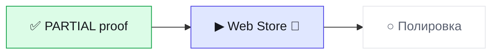

# Статус · topath-saver · BRO v3.0
Обновлено 2026-10-13 14:30 · режим JOIN · волна W4-STORE

▰▰▰▱▱▱▱▱ **1 из 3 · 33 %** · сейчас «Web Store» · ход за 🤖 кодер

**Тебе:** ничего — ждём «Готово» от кодера · **Дальше:** 🛑 Web Store — сейчас

| Показатель | Значение |
|---|---|
| 🎯 Принято с первого раза | 1/3 |
| 🙈 Ложные «готово» | 1 |
| ⏱ Последняя волна: работа / ожидание, мин | 7 / - |
| 🪙 ≈ptok на принятую задачу | 1666 |
| 🔌 Обращений к GitHub за волну (среднее) | 10.7 |

Волны · 3

| W | verdict | done/tasks | defects | min | GitHub |
|---|---|---|---|---|---|
| W1-INIT | PARTIAL | 5/6 | 3 | 11 | 9 |
| W2-RELEASE | PASS | 6/6 | 0 | 6 | 5 |
| W3-FIX | PARTIAL | 5/5 | 2 | 7 | 18 |

Страница на ПК: `.bro\progress.html` (двойной щелчок).
