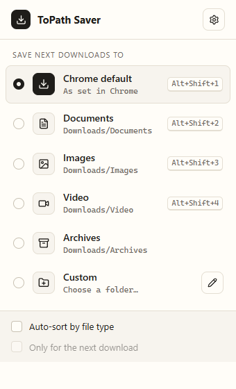
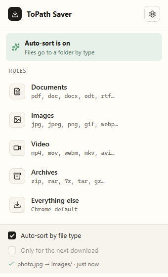
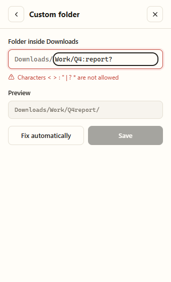
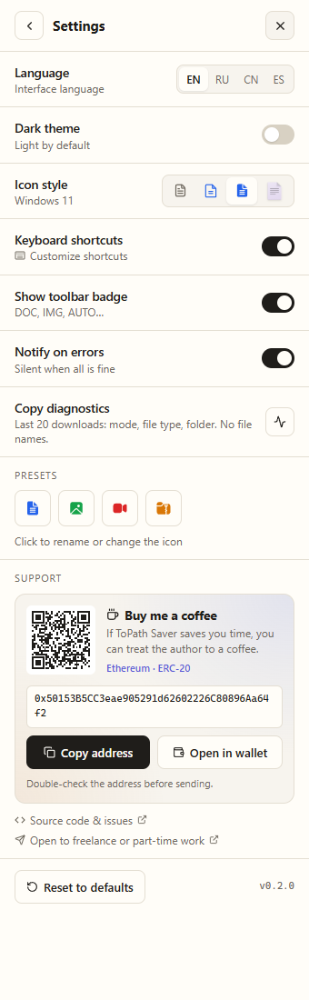
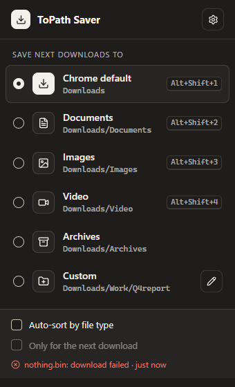

# ToPath Saver

**Switch your download folder in two clicks.** A tiny Chrome extension with folder presets, auto-sort by file type and keyboard shortcuts — no tracking, no network, no setup.

[Releases](https://github.com/helpfulbriefl/topath-saver/releases) · [Changelog](CHANGELOG.md) · [Privacy](PRIVACY.md) · [Русский](README.ru.md) · [Report an issue](https://github.com/helpfulbriefl/topath-saver/issues) · [☕ Buy me a coffee](#-support)

[](https://github.com/helpfulbriefl/topath-saver/actions/workflows/checks.yml)
[](https://github.com/helpfulbriefl/topath-saver/releases/latest)
[](LICENSE)
[](#-support)


Chrome · Edge · Brave (Chromium 116+) · English, Russian, Simplified Chinese and Spanish · Light and dark theme



## Why ToPath Saver?

| Workflow | What you get |
| --- | --- |
| Switching folders | Pick **Documents**, **Images**, **Video**, **Archives** or your own folder in the popup — every next download goes there. No more "Save as…" dialogs. |
| Sorting automatically | Turn on **Auto-sort by file type**: pdf → Documents, jpg → Images, mp4 → Video, zip → Archives. Unknown types stay in Chrome's default folder. |
| One-off downloads | **Only for the next download** — route one file and return to Chrome default automatically. |
| Your own structure | A custom folder like `Work/Q4` with live validation and **Fix automatically** for illegal characters. Presets are editable: name, folder, icon. |
| Speed | Keyboard shortcuts **Alt+Shift+1…4** and a toolbar badge (`DOC`, `IMG`, `VID`, `ZIP`, `DIR`, `AUTO`) that always shows where files go. |
| Safety | If something fails, you get a notification with **Retry** and **Open folder**. The file is never lost — Chrome keeps it in Downloads. |

Folders are created silently on the first download. The style is calm "paper": light by default, dark in one switch.

### Screenshots

| Auto-sort | Custom folder |
| --- | --- |
|  |  |

| Settings | Dark theme |
| --- | --- |
|  |  |

These screenshots are generated by the Playwright stand on the real build, not mockups.

## Get started

1. Download **topath-saver-*-chrome.zip** from the [latest release](https://github.com/helpfulbriefl/topath-saver/releases/latest) and unzip it to a folder you keep. Verify it against **SHA256SUMS.txt** if needed.
2. Open `chrome://extensions`, turn on **Developer mode**, click **Load unpacked** and select the unzipped folder.
3. Pin ToPath Saver to the toolbar, click it and choose a folder. Done.

A Chrome Web Store listing is on the way.

**Limits.** Chrome lets extensions save only **inside your Downloads folder** (subfolders are fine, other drives are not). If "Ask where to save each file" is on in Chrome settings, Chrome's dialog opens in the chosen subfolder.

## Keyboard shortcuts

| Action | Shortcut |
| --- | --- |
| Chrome default | Alt+Shift+1 |
| Documents | Alt+Shift+2 |
| Images | Alt+Shift+3 |
| Video | Alt+Shift+4 |
| Archives / Custom | not assigned — set them in `chrome://extensions/shortcuts` |

Chrome allows at most four suggested shortcuts per extension. You can change all of them in `chrome://extensions/shortcuts` or turn them off in **Settings → Keyboard shortcuts**.

## Privacy

No analytics, no telemetry, **no network requests at all**. Settings live in `chrome.storage.local` on your device. Permissions: `downloads`, `storage`, `notifications`. Details: [PRIVACY.md](PRIVACY.md).

## Build and test

Use **Node.js 22+**.

```bash
npm ci
npx playwright install chromium
npm run gates      # tsc · vitest · wxt build · Playwright stand on the real build
npm run dev        # Chrome with hot reload
npm run zip        # .output/topath-saver-<version>-chrome.zip
```

The stand (`tests/stand/`) loads the built extension into real Chromium, clicks through the popup like a person and makes **real downloads** from a local `127.0.0.1` server, then checks where each file landed. `DOCS=1 npm run stand` refreshes the README screenshots.

| Directory | Responsibility |
| --- | --- |
| `entrypoints/background.ts` | Service worker: routes downloads (`onDeterminingFilename`), badge, notifications, shortcuts. |
| `entrypoints/popup/` | React popup: main list, custom folder, preset editor, settings. |
| `lib/` | Pure logic: path validation, auto-sort rules, state, router, i18n, storage. |
| `public/_locales/` | Store/manifest strings in four languages. |
| `tests/unit/` | Vitest unit tests for `lib/`. |
| `tests/stand/` | Playwright end-to-end stand with real downloads. |
| `.bro/` | Development log and specs of the analyst ↔ coder workflow. |

## Project status and collaboration

ToPath Saver is an independent, solo-maintained project. Bug reports, translations and ideas are welcome — open an [issue](https://github.com/helpfulbriefl/topath-saver/issues) before proposing a large change.

**I'm open to work.** I build browser extensions, desktop tools and web apps end to end — as an independent developer, on freelance projects or part-time in a team. Write to [@yumi_acess](https://t.me/yumi_acess) or visit my [portfolio](https://helpfulbriefl.github.io/).

## ☕ Support

If ToPath Saver saves you time, you can buy me a coffee. Thank you!


**Ethereum (ERC-20)** — ETH or tokens on the Ethereum network:

```text
0x50153B5CC3eae905291d62602226C80896Aa64f2
```

Please double-check the address and the network before sending. The same card with a QR code and a copy button is in the extension: **Settings → Support**.

<br clear="right">

## License and credits

[MIT](LICENSE) © 2026 helpfulbriefl. Icons: [Lucide](https://lucide.dev) (ISC). Built with [WXT](https://wxt.dev) (MIT), [React](https://react.dev) (MIT) and [Tailwind CSS](https://tailwindcss.com) (MIT).
